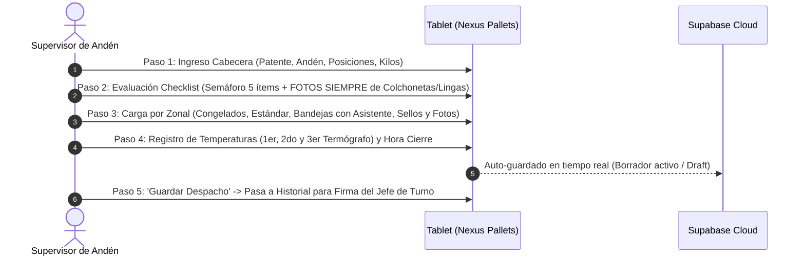
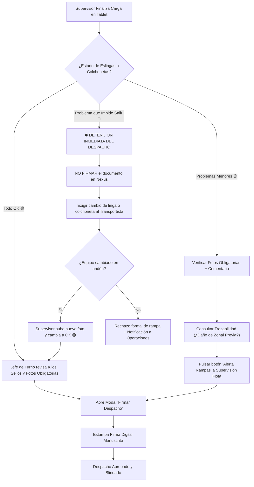

# 📘 MANUAL DE PROCEDIMIENTOS OPERATIVOS ESTÁNDAR (SOP)
## CONTROL OUTBOUND CIAL — PLATAFORMA NEXUS PALLETS
**Código:** SOP-LOG-NEXUS-001  
**Versión:** 2.2  
**Fecha de Emisión:** Octubre 2026  
**Área Responsable:** Gerencia de Logística y Cadena de Suministro / Operaciones CD San Bernardo  
**Plataforma Oficial:** `pallet.nexusnetwork.cl` (Nexus Outbound)  
**Estándares de Referencia:** HACCP (Cadena de Frío), ISO 9001 (Control Operacional), CIS Controls v8 (Seguridad de Datos)

---

## 1. OBJETIVO Y ALCANCE

### 1.1. Objetivo
Estandarizar el procedimiento operativo de inspección, llenado en tablet, captura fotográfica especializada, gestión de cambio de turno y despacho de camiones frigoríficos cargados con pallets y bandejas desde el Centro de Distribución San Bernardo hacia las zonales a nivel nacional, asegurando:
1. La integridad física de la carga y el balance exacto de embalaje retornable (pallets de madera, plástico y bandejas carniceras).
2. El aseguramiento ininterrumpido de la cadena de frío (-18°C congelados / 0° a 4°C refrigerados).
3. **La captura fotográfica obligatoria del 100% de los despachos** (equipamiento de rampa, pallets de congelados, refrigerados, bandejas y sellos) para garantizar la **trazabilidad de daños y determinar exactamente dónde se dañaron** los equipos o embalajes.
4. El protocolo de llenado en tablet, traspaso de custodia en Cambio de Turno y la validación/firma digital obligatoria del Jefe de Turno ante desviaciones operacionales.

### 1.2. Alcance
Aplica a todo el personal involucrado en el proceso de despacho Outbound en CIAL Alimentos:
* **Supervisores de Andén / Despacho:** Responsables de inspección en terreno, llenado en tablet, toma de fotografías obligatorias y entrega/recepción de turno.
* **Jefes de Turno de Despacho y CD:** Responsables de revisión documental, gestión de alertas operacionales y firma digital de autorización.
* **Conductores y Transportistas:** Responsables de presentación del equipo móvil, estiba y entrega de eslingas operativas.
* **Supervisores de Flota / Rampas:** Receptores de alertas preventivas y correctivas por daño en equipamiento.

---

## 2. MATRIZ DE RESPONSABILIDADES (RACI)

| Actividad / Etapa | Supervisor Andén | Jefe de Turno | Conductor | Supervisor Rampas |
|---|:---:|:---:|:---:|:---:|
| Verificación física del camión y luces en andén | **R** | **A** | **C** | **I** |
| Registro de cabecera y andén en tablet | **R** | **A** | **I** | **I** |
| Captura fotográfica obligatoria (equipamiento y pallets) | **R** | **A** | **I** | **I** |
| Calificación del semáforo (Sin revisar / OK / Problemas menores / Impide salir) | **R** | **A** | **C** | **I** |
| Ejecución de Cambio de Turno en plataforma | **R** | **A** | **I** | **I** |
| Notificación y escalamiento de fallas en Amarillo/Rojo | **R** | **A / R** | **I** | **C / R** |
| Validación documental y control Poka-Yoke | **C** | **R / A** | **I** | **I** |
| Estampado de Firma Digital Manuscrita | **C** | **R / A** | **I** | **I** |
| Autorización final de salida y cierre de puertas | **C** | **A** | **R** | **I** |

*Leyenda: **R** = Responsable de ejecutar; **A** = Aprobador final / Accountable; **C** = Consultado / Colaborador; **I** = Informado.*

---

## 3. PROTOCOLO TÉCNICO DE CAPTURA FOTOGRÁFICA EN ANDÉN

> [!IMPORTANT]
> **REGLA DE ORO DE TRAZABILIDAD:** **LAS FOTOS DE COLCHONETAS Y LINGAS SE TOMAN SIEMPRE (EN EL 100% DE LOS CAMIONES)**, incluso cuando el semáforo está en **🟢 OK**.
> La fotografía es el único respaldo fehaciente que permite demostrar en qué estado salió el equipo del CD San Bernardo y esclarecer **dónde se dañaron** las colchonetas o lingas si se detecta una anomalía en la zonal de destino o en el retorno.

```
                           CÁMARA / TABLET
                                  │
          ┌───────────────────────┼───────────────────────┐
          ▼                       ▼                       ▼
    SECTORIZACIÓN            BANDEJAS POR TIPO        EQUIPAMIENTO
  Congelado vs. Refrig.     Fotos agrupadas:        SIEMPRE OBLIGATORIAS:
  Encuadre: 6 pallets       ej. 40x3 y luego 25x2   Colchonetas y Lingas
```

### 3.1. Requisitos Técnicos Previos en Andén
1. **Limpieza del lente:** Limpiar el lente de la tablet con paño de microfibra seco. En andenes de frío, esperar 30 segundos a que se disipe el choque térmico y secar la condensación antes de disparar.
2. **Iluminación activa:** Focos de andén y plafones interiores del camión 100% encendidos (ítem 3 del checklist en Verde). Prohibido fotografiar en penumbra.
3. **Uso de la herramienta nativa:** Utilizar el botón **"📸 Tomar Foto"** directo en Nexus Outbound (activa la cámara trasera con autoenfoque `capture="environment"`).

---

### 3.2. Separación de Fotos: Congelado vs. Refrigerado (Técnica de los 6 Pallets)

En furgones frigoríficos bi-temperatura o con separadores térmicos, está **estrictamente prohibido mezclar fotos de cámaras distintas** en una sola toma confusa:

1. **Separación de Cámaras:**
   * **Cámara de Congelados (-18°C):** Se deben tomar fotos exclusivas de los pallets de congelados antes de cerrar o fijar el separador térmico.
   * **Cámara de Refrigerados (0° a 4°C / Seco):** Se toman fotos independientes de los pallets del sector refrigerado una vez instalado el separador.
2. **Técnica de los 6 Pallets de Largo:**
   * Debido a la profundidad del furgón y el límite de iluminación del foco de andén, el campo visual óptimo cubre un largo de **6 pallets** (3 pares de pallets a lo largo del pasillo central).
   * **Cómo disparar:**
     * Pararse en la rampa de andén a 1.5 metros de la culata o de la división.
     * Encuadrar en ángulo frontal-inclinado a 45° de modo que la cámara capture claramente los primeros **6 pallets de fondo**.
     * Si la cámara o compartimiento tiene mayor profundidad, tomar la primera foto de los 6 pallets iniciales y una segunda toma enfocando el fondo antes de completar la estiba.

---

### 3.3. Fotografías de Bandejas Carniceras y Fórmula (Regla de Agrupación)

En despachos de zonales que incluyen bandejas plásticas carniceras desglosadas por fórmula (por ejemplo: `40x3 + 25x2`), se debe cumplir la siguiente directriz fotográfica:

```
    [ FOTO 1: TORRES DE 40 ]             [ FOTO 2: TORRES DE 25 ]
    ┌────┐  ┌────┐  ┌────┐               ┌────┐  ┌────┐
    │ 40 │  │ 40 │  │ 40 │               │ 25 │  │ 25 │
    ├────┤  ├────┤  ├────┤               ├────┤  ├────┤
    │BASE│  │BASE│  │BASE│               │BASE│  │BASE│
    └────┘  └────┘  └────┘               └────┘  └────┘
    Torres del mismo tipo                Torres del segundo tipo
```

1. **Número de Fotos Requerido:** Se deben tomar **1 o 2 fotos exclusivas para las bandejas**, nunca una foto general lejana donde no se distinga la altura de los pisos.
2. **Fotos por Mismo Tipo de Torre (Agrupadas):**
   * **Foto 1 (Torres del primer estándar):** Encuadrar juntas todas las columnas de la misma altura. En el ejemplo `40x3`, fotografiar de frente las **3 torres de 40 bandejas** sobre sus respectivas bases plásticas.
   * **Foto 2 (Torres del segundo estándar):** Encuadrar juntas las columnas de la siguiente altura. En el ejemplo `+ 25x2`, fotografiar de frente las **2 torres de 25 bandejas**.
3. **Puntos Críticos de Validación:**
   * Debe apreciarse la uniformidad de las bandejas (sin bandejas rotas ni inclinadas).
   * Debe verse la **base plástica** inferior que soporta cada torre.
   * Permite al receptor en zonal y al auditor contar los pisos visualmente con total rapidez.

---

### 3.4. Fotos de Equipamiento de Rampa (Siempre Obligatorias) y Sellos

#### A. Separador Térmico / Colchonetas (`colchonetas_photos`) — **SIEMPRE OBLIGATORIA**
* **¿Por qué en todos los camiones?** Si una zonal devuelve una colchoneta rasgada o sucia acusando que "así venía desde San Bernardo", la foto de salida en la plataforma es la evidencia que prueba si el daño se originó en ruta/zonal o si venía desde el CD.
* **Encuadre:** Foto panorámica completa de la colchoneta colocada, mostrando el sellado perimetral contra paredes y techo, velcros y barras de sujeción.

#### B. Lingas del Camión (`lingas_photos`) — **SIEMPRE OBLIGATORIA**
* **¿Por qué en todos los camiones?** Permite saber si el camión salió con sus eslingas completas y sanas, deslindando pérdidas o roturas durante las faenas de descarga en zonales intermedias.
* **Encuadre:** Plano medio de la linga tensada sobre el último pallet, mostrando el enganche al riel logístico y el trinquete bloqueado.

#### C. Sello de Seguridad de Ruta
* Primer plano directo al sello trabado. **El número de serie grabado (ej. `017315`) debe ser 100% legible**. Desactivar el flash si produce reflejo sobre el plástico o metal.

---

## 4. CHECKLIST OPERATIVO Y MATRIZ DEL SEMÁFORO (DEFINICIONES OFICIALES)

El checklist consta de **5 ítems obligatorios**. Cada uno opera bajo un selector cíclico con las siguientes definiciones normativas:

$$\text{⚪ SIN REVISAR} \longrightarrow \text{🟢 OK} \longrightarrow \text{🟡 PROBLEMAS MENORES} \longrightarrow \text{🔴 PROBLEMA QUE IMPIDE SALIR}$$

```
                   ESTADOS OFICIALES DEL CHECKLIST
   ┌──────────────────────┬──────────────────────┬──────────────────────────┬───────────────────────────────┐
   │    ⚪ SIN REVISAR    │        🟢 OK         │   🟡 PROBLEMAS MENORES   │  🔴 PROBLEMA QUE IMPIDE SALIR │
   ├──────────────────────┼──────────────────────┼──────────────────────────┼───────────────────────────────┤
   │ Estado inicial       │ Equipo conforme      │ Desgaste o anomalía leve │ Daño crítico / Riesgo inminente│
   │ Alerta Poka-Yoke     │ 100% operativo       │ No compromete la carga   │ Fuga de frío o caída de carga │
   │ No permite cerrar    │ FOTO OBLIGATORIA     │ FOTO + COMENTARIO OBLIG. │ CAMIÓN RETENIDO EN ANDÉN      │
   │ sin evaluación       │ para trazabilidad    │ Aviso / Alerta a Flota   │ REEMPLAZO OBLIGATORIO PREVIO  │
   └──────────────────────┴──────────────────────┴──────────────────────────┴───────────────────────────────┘
```

### 4.1. Definición Detallada de Estados

1. **⚪ SIN REVISAR (Gris):**
   * Estado por defecto al iniciar la carga.
   * Representa que el supervisor aún no ha verificado físicamente el punto en andén.
   * **Control Poka-Yoke:** El sistema emite advertencia si se intenta finalizar o firmar con ítems sin revisar.
2. **🟢 OK (Verde):**
   * Equipo en condiciones óptimas de operación.
   * Separador térmico hermético, limpio y sin rasgaduras. Lingas completas, cintas sanas y trinquetes operativos.
   * **Mandato operacional:** **Se toma la fotografía obligatoria de respaldo** para certificar que el camión sale conforme del CD.
3. **🟡 PROBLEMAS MENORES (Amarillo):**
   * Desperfecto superficial o desgaste estético que **NO** compromete la seguridad física de la estiba ni la cadena de frío.
   * *Ejemplo Separador:* Rasgadura superficial en la cubierta de lona que no expone la espuma aislante ni produce fuga térmica.
   * *Ejemplo Lingas:* Deshilachado leve en el borde externo de la cinta (<10%) sin cortes estructurales, con trinquete 100% funcional.
   * **Requisito obligatorio:** **Foto de evidencia + Comentario técnico descriptivo**. El sistema activa la revisión de trazabilidad previa y permite emitir la alerta a mantenimiento de rampas.
4. **🔴 PROBLEMA QUE IMPIDE SALIR (Rojo):**
   * Falla crítica que pone en riesgo inminente la inocuidad alimentaria (fuga de frío) o la seguridad de transporte (caída o vuelco de carga).
   * *Ejemplo Separador:* Rotura abierta con espuma expuesta, humedad interna acumulada, deformación severa o ausencia total de colchoneta en furgón bi-temperatura.
   * *Ejemplo Lingas:* Linga cortada, amarrada con nudos improvisados, trinquete trabado/roto, o cantidad insuficiente de lingas para afianzar la carga.
   * **Impacto Operacional:** **EL CAMIÓN NO PUEDE SALIR**. El Jefe de Turno tiene prohibido firmar hasta que el transportista o el pañol sustituyan físicamente el equipo en andén.

---

## 5. GUÍA PASO A PASO: CÓMO RELLENAR LA TABLET EN NEXUS OUTBOUND

El registro en la tablet se realiza directamente en la dirección `pallet.nexusnetwork.cl` a través de los siguientes módulos secuenciales:



### Paso 1: Datos de Cabecera y Capacidad del Camión
1. **Patente y Número de Camión:** Ingresar la patente del furgón (ej. `GR-2849`) o número de flota.
2. **Número de Andén:** Digitar el andén operativo de carga (ej. `Andén 04`).
3. **Capacidad del Camión (Posiciones):**
   * Utilizar la botonera rápida con los estándares oficiales de CIAL:
     $$\mathbf{[14]} \quad \mathbf{[24]} \quad \mathbf{[26]} \quad \mathbf{[28]} \quad \mathbf{[30]} \quad \mathbf{[32]}$$
   * O ajustar con los botones `+` / `-` según la capacidad real del furgón.
4. **Kilos Totales del Camión:**
   * Ingresar el tonelaje total exacto según la **Guía de Ruta** emitida por Despacho (ej. `21.116 kg`).

---

### Paso 2: Checklist Operacional de 5 Puntos (Fotos Siempre Obligatorias)
Hacer clic sobre cada botón de estado para alternar:
$$\text{⚪ SIN REVISAR} \longrightarrow \text{🟢 OK} \longrightarrow \text{🟡 PROBLEMAS MENORES} \longrightarrow \text{🔴 PROBLEMA QUE IMPIDE SALIR}$$

1. **1. Horario de postura en el Andén:** Verificar puntualidad de acople del camión.
2. **2. Estado camión (Limpieza, Sin daños):** Validar piso limpio, seco y sin olores.
3. **3. Estado de Luces (ENCENDIDAS):** Encender luces interiores y foco de andén.
4. **4. Verificación Separador Térmico:**
   * Calificar: 🟢 OK, 🟡 Problemas menores o 🔴 Problema que impide salir.
   * **Tomar FOTO SIEMPRE** en el botón **"📸 Fotos Colchonetas"**.
   * Si está en 🟡 o 🔴: escribir comentario descriptivo detallando la anomalía.
5. **5. Verificación Lingas por camión:**
   * Calificar: 🟢 OK, 🟡 Problemas menores o 🔴 Problema que impide salir.
   * **Tomar FOTO SIEMPRE** en el botón **"📸 Fotos Lingas"**.
   * Si está en 🟡 o 🔴: escribir comentario descriptivo detallando la anomalía.

---

### Paso 3: Desglose y Carga por Zonal de Destino
Para cada zonal asignado en la hoja de ruta del camión:
1. **Seleccionar Zonal:** Escoger de la lista oficial (ej. Chillán, Talca, Concepción, etc.).
2. **N° de Viaje y Lugar en Camión:** Especificar si es Viaje 1 o 2, y su ubicación (`Fondo`, `Medio` o `Culata`).
3. **Ingreso de Embalaje por Categoría:**
   * **Congelados:** Digitar Kilos, Pallets Madera (Bases y Extra) y Pallets Plástico (Bases y Extra).
   * **Estándar:** Digitar Kilos, Pallets Madera y Pallets Plástico.
   * **Bandejas Carniceras (Uso del Asistente):**
     * Presionar el botón **"Calculadora / Asistente de Bandejas"** (icono de medalla/premio).
     * Ingresar la cantidad de pallets por cada altura:
       * Casilla `40`: Digitar `3` (genera $40 \times 3 = 120$ bandejas).
       * Casilla `25`: Digitar `2` (genera $25 \times 2 = 50$ bandejas).
       * Si hay bandejas sueltas, ingresar en `Restante`.
     * Presionar **"APLICAR"**: El sistema genera automáticamente la fórmula `40x3 + 25x2`, suma el total de bandejas ($170$) y asigna automáticamente las **5 bases plásticas**.
4. **N° de Sello:** Digitar el número del sello colocado en el compartimiento o puerta.
5. **Fotos del Zonal:**
   * Presionar **"📸 Tomar Foto"** (hasta 10 fotos por zonal).
   * Subir la foto de los 6 pallets (congelados/refrigerados) y las 1 o 2 fotos de bandejas agrupadas por tipo.

---

### Paso 4: Temperaturas de Termógrafos y Hora de Cierre
1. **Registro de Temperaturas:**
   * **1er Termógrafo:** Temperatura en cabecera / salida del evaporador (congelado: $\le -18^\circ\text{C}$).
   * **2do Termógrafo:** Temperatura en el sector medio del furgón.
   * **3er Termógrafo:** Temperatura en la culata / compuerta trasera.
2. **Hora de Cierre:** Registrar la hora exacta en que se cerraron las puertas del camión en andén.

---

### Paso 5: Guardado y Envío para Firma
* El sistema cuenta con **auto-guardado local y en la nube en tiempo real** (protege contra pérdidas de conexión).
* Una vez completados los zonales, presionar **"GUARDAR DESPACHO"**. El camión se traslada de *Borradores Activos* al *Historial Oficial* en estado **"Pendiente de Firma"**.

---

## 6. PROCEDIMIENTO DE CAMBIO DE TURNO (SHIFT HANDOVER)

Aplica cuando una faena de carga comienza en un turno (ej. Turno Tarde) y debe continuar o despacharse en el siguiente (ej. Turno Noche):

```
   TURNO SALIENTE                              TURNO ENTRANTE
┌────────────────────┐                     ┌────────────────────┐
│ Camión en carga    │   Botonera:         │ Camión recibido en │
│ parcial en andén   │ ──[🔄 Cambio Turno]─>│ tablet con marca   │
│ Supervisor A       │   Selecciona B      │ de auditoría       │
└────────────────────┘                     └────────────────────┘
```

### 6.1. Acciones del Supervisor Saliente
1. **Guardar Avance Actual:** Asegurarse de que todos los zonales cargados hasta el momento y el checklist inicial queden guardados en el borrador.
2. **Ejecutar Cambio de Turno:**
   * En la tarjeta del camión (en la sección *Camiones en Carga* o en el *Historial del Día*), hacer clic en el botón **"🔄 Cambio de Turno"**.
3. **Seleccionar Supervisor Entrante:**
   * Se abrirá el modal de traspaso con la lista de usuarios activos de CIAL.
   * Seleccionar el nombre del supervisor entrante que asume el andén.
   * Confirmar la transferencia.
4. **Registro de Auditoría:**
   * La plataforma graba automáticamente en base de datos:
     * `created_by`: Supervisor original que inició la carga.
     * `shared_with`: Correo del supervisor receptor.
     * `shift_handover_at`: Fecha y hora exacta del traspaso (`America/Santiago`).

---

### 6.2. Acciones del Supervisor Entrante
1. **Recepción en Tablet:**
   * Al iniciar sesión en su tablet, el supervisor entrante verá el camión en su bandeja con el distintivo **"Traspasado por [Nombre Supervisor Saliente]"**.
   * Ahora tiene **plenos permisos de edición** sobre el borrador.
2. **Inspección Física de Entrega en Terreno:**
   * Acudir al andén correspondiente y verificar físicamente:
     * Que las posiciones cargadas coincidan con lo anotado en la tablet.
     * Que las colchonetas y lingas se encuentren en la misma condición reportada y que sus fotos de salida estén cargadas.
3. **Finalización de la Carga:**
   * Continuar completando los zonales restantes, tomar las fotos correspondientes, registrar las temperaturas finales y la hora de cierre de puertas.
4. **Solicitud de Firma:** Solicitar la firma al Jefe de Turno de su jornada de trabajo.

---

## 7. PROTOCOLO DEL JEFE DE TURNO: FIRMA Y GESTIÓN DE INCIDENCIAS

El Jefe de Turno revisa, valida y autoriza la salida del camión mediante firma digital manuscrita.



### 7.1. Protocolo ante PROBLEMAS MENORES 🟡
1. **Requisitos de Sistema:** Verificar que existan fotos adjuntas y comentario explicativo del desgaste menor.
2. **Revisión de Trazabilidad:** Consultar en Nexus Outbound si el camión ya traía la observación desde una zonal de descarga previa (ej. *"Daño detectado originado en Zonal Chillán"*), liberando de responsabilidad al CD San Bernardo.
3. **Envío de Alerta:** Presionar el botón **"🚨 Alerta Inspección Rampas"** para despachar el correo preformateado a mantenimiento de flota.
4. **Autorización:** Estampar firma digital manuscrita.

---

### 7.2. Protocolo ante PROBLEMA QUE IMPIDE SALIR 🔴
> [!CAUTION]
> **PROHIBICIÓN ESTRICTA DE DESPACHO:** Ningún camión con colchoneta rota (fuga térmica) o lingas cortadas/inoperativas puede recibir la firma del Jefe de Turno ni salir de San Bernardo.

1. **Retención:** Paralizar el cierre de puertas y retener el camión en andén.
2. **Reemplazo Obligatorio:** Exigir al transportista o al pañol de andén la sustitución inmediata de la linga o colchoneta dañada por una unidad certificada.
3. **Actualización en Tablet:** El supervisor toma la nueva foto del equipo instalado, cambia el semáforo a **🟢 OK** y anota el reemplazo en observaciones.
4. **Firma:** Una vez en OK, el Jefe de Turno procede a firmar. Si no hay reemplazo, el camión queda **RECHAZADO**.

---

### 7.3. Firma Digital y Regla de Inmutabilidad
* La firma se estampa en el modal morado **"✍️ Firmar"** previo chequeo de alertas Poka-Yoke (campos incompletos o bitácora de atrasos pendiente).
* Queda vinculada a la hora oficial chilena (`America/Santiago`) y al correo corporativo (`@cial.cl`).
* **Regla de Inmutabilidad:** Si un despacho ya firmado es editado por cualquier motivo, **la firma digital se anula automáticamente**, obligando a una nueva revisión y firma por parte de la Jefatura de Turno.

---

## 8. ANEXO: RESUMEN RÁPIDO PARA EL SUPERVISOR Y JEFE DE TURNO

```
╔══════════════════════════════════════════════════════════════════════════════╗
║                       CHECKLIST RÁPIDO DE OPERACIÓN                          ║
╠══════════════════════════════════════════════════════════════════════════════╣
║ 📸 FOTOS SIEMPRE OBLIGATORIAS (100% DE LOS CAMIONES):                        ║
║    • Colchonetas y Lingas SE FOTOGRAFIAN SIEMPRE, para saber dónde se dañaron║
║      si en destino o retorno reportan averías.                               ║
║    • Separar fotos de CONGELADOS vs. REFRIGERADOS (No mezclar cámaras).      ║
║    • Encuadre de 6 PALLETS DE LARGO (campo visual nítido del andén).         ║
║    • BANDEJAS (ej. 40x3 + 25x2): 1 o 2 fotos agrupando torres del mismo      ║
║      tipo (foto 1 para las de 40, foto 2 para las de 25).                    ║
║    • Foto nítida del SELLO sin reflejo de flash.                             ║
║                                                                              ║
║ 🚦 SEMÁFORO DEL CHECKLIST:                                                   ║
║    • ⚪ Sin revisar: Estado inicial no evaluado.                             ║
║    • 🟢 OK: Conforme (foto obligatoria de respaldo de salida).               ║
║    • 🟡 Problemas menores: Desgaste leve (foto + comentario + alerta flota). ║
║    • 🔴 Problema que impide salir: RETENCIÓN DE CAMIÓN. Cambio en andén.     ║
║                                                                              ║
║ 📱 LLENADO TABLET & CAMBIO DE TURNO:                                         ║
║    • Posiciones rápidas: 14, 24, 26, 28, 30, 32.                             ║
║    • Asistente de Bandejas: Calcula automático total unidades y bases.       ║
║    • Botón 'Cambio de Turno': Seleccionar supervisor entrante.               ║
║                                                                              ║
║ 🛑 REGLA DE ORO DEL JEFE DE TURNO:                                           ║
║    • NUNCA firmar con Lingas o Separador en 🔴 Problema que impide salir.     ║
║    • Exigir cambio de equipo antes de cerrar puertas.                        ║
╚══════════════════════════════════════════════════════════════════════════════╝
```
